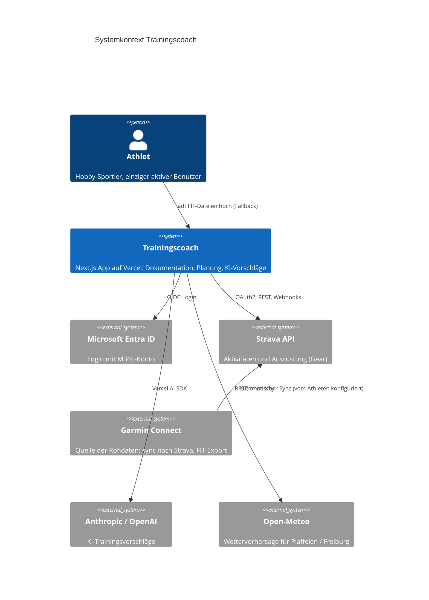
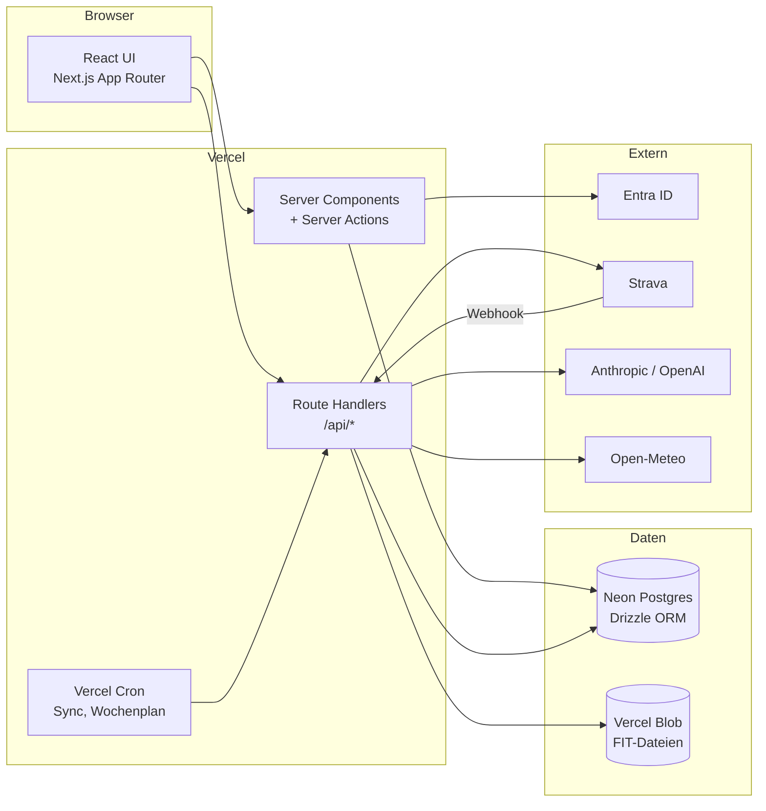
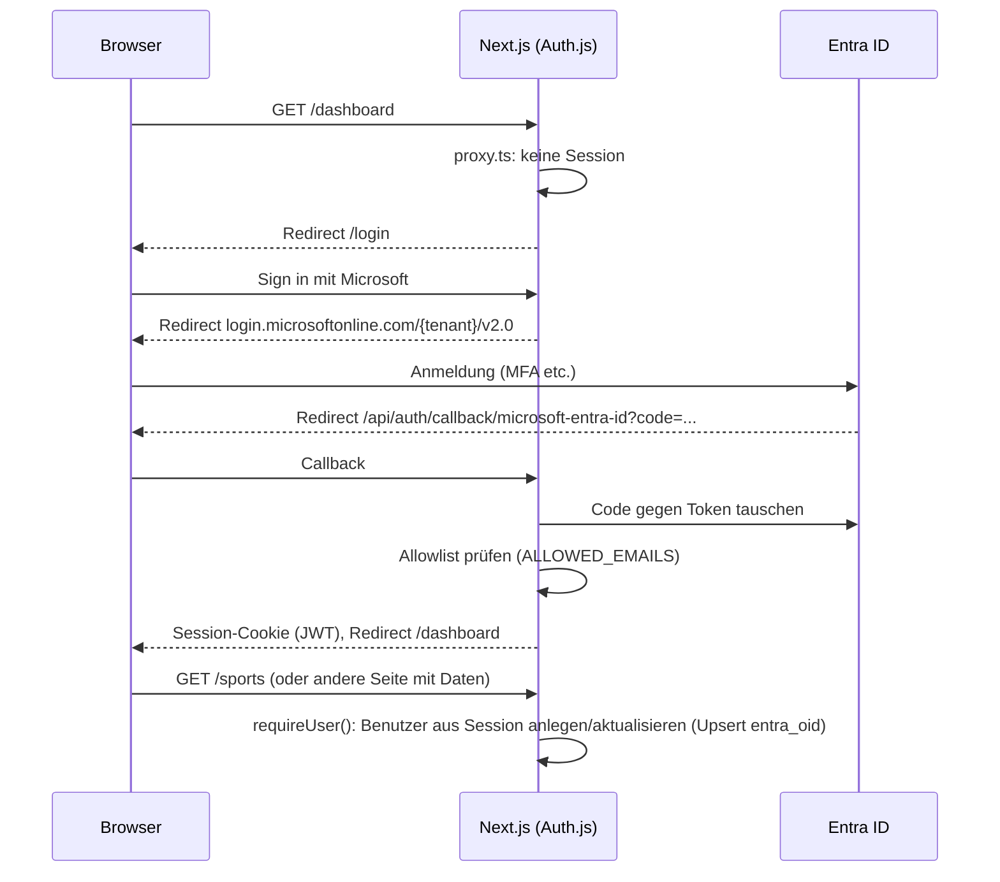
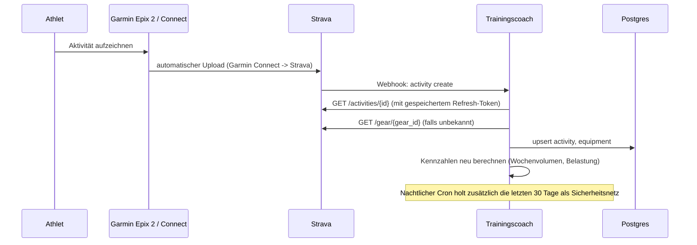
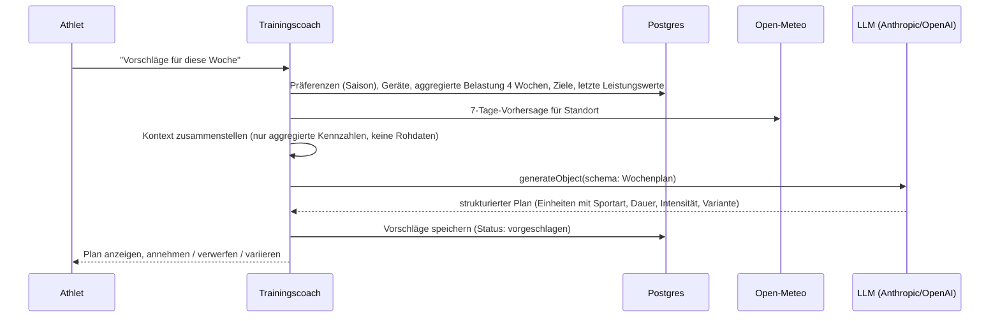
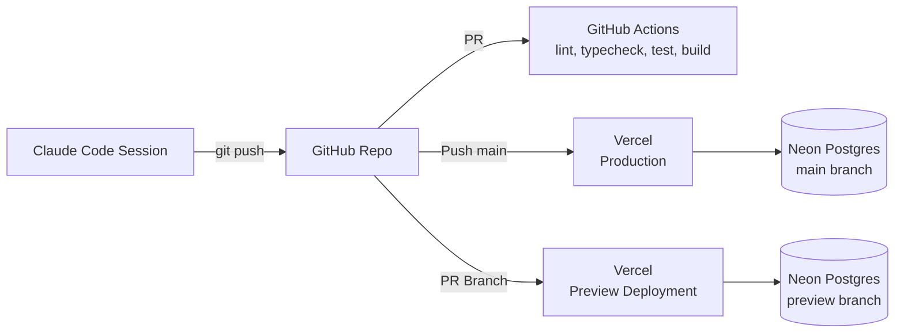

# 02 – Architektur

## Systemkontext



## Container



## Technologie-Entscheidungen

| Bereich | Wahl | Begründung |
|---|---|---|
| Framework | Next.js 16 (App Router, TypeScript) | Vercel-nativ, Server Components, Route Handlers, Cron |
| UI | Tailwind CSS 4 | Schnell, keine Design-System-Abhängigkeit |
| Auth | Auth.js v5 (`next-auth@beta`) mit Provider `microsoft-entra-id` | Offizieller Entra-ID-Provider, JWT-Session ohne DB-Adapter |
| DB | Neon Postgres + Drizzle ORM | Serverless, Vercel-Marketplace, typsichere Migrationen |
| Dateien | Vercel Blob | FIT-Uploads, einfache Anbindung |
| KI | Vercel AI SDK 7 (`ai`, `@ai-sdk/anthropic`, `@ai-sdk/openai`) | Ein Interface, Anbieter per Env umschaltbar, strukturierte Ausgaben mit Zod |
| Wetter | Open-Meteo | Kostenlos, ohne Key, 7-Tage-Vorhersage |
| Tests | Vitest | Schnell, TS-nativ |
| CI | GitHub Actions | Lint, Typecheck, Build, Tests pro PR |

Details zu den Entscheidungen in `docs/adr/`.

## Modulstruktur (Code)

```text
src/
  app/                    Routen (App Router)
    (auth)/login          Login-Seite
    dashboard/            Übersicht, Fortschritt
    activities/           Aktivitätenliste, Detail, manuelle Erfassung, FIT-Upload
    plan/                 Wochenplan und KI-Vorschläge
    sports/               Sportarten und saisonale Präferenzen (Liste, new, [id]; actions.ts)
    equipment/            Sportgeräte (Liste, new, [id]; actions.ts)
    metrics/              Körpergewicht, Leistungswerte
    settings/connectors/  Strava verbinden, KI-Anbieter
    api/auth/[...nextauth] Auth.js Handler
    api/strava/*          OAuth-Callback, Webhook, Sync
    api/coach/*           KI-Vorschläge
    api/cron/*            geplante Jobs
  auth.ts                 Auth.js Konfiguration
  proxy.ts                Routen-Schutz (Next.js 16 "Proxy", früher Middleware)
  db/                     Drizzle Schema, Client, Migrationen
  lib/
    users.ts              Session -> DB-Benutzer (Upsert)
    master-data/          DB-Zugriffe für Sportarten, Präferenzen, Geräte, Seed
    domain/               reine Fachlogik (Saison, Belastung, Präferenzen, Seed-Daten), gut testbar
    strava/               API-Client, Mapping Strava -> Activity
    fit/                  FIT-Parser
    ai/                   Provider-Auswahl, Prompts, Zod-Schemas
    weather/              Open-Meteo Client
  components/             UI-Bausteine (AppShell, NavLinks, SeasonProfile, PageHeader, SubmitButton, DeleteButton, ui.ts)
drizzle/                  generierte SQL-Migrationen (db:generate / db:migrate)
docs/                     Architektur, ADRs, Setup
.claude/                  Projekt-Skills und Einstellungen für Claude Code
```

## Ablauf: Login



Seiten und Server Actions, die Daten lesen oder schreiben, holen den Benutzer
über `lib/users.ts#requireUser()`. Server Actions prüfen die Session damit
selbst, weil sie per POST direkt erreichbar sind.

## Ablauf: Strava-Sync



## Ablauf: KI-Trainingsvorschlag



Wichtig: Der KI-Kontext enthält **nur aggregierte und selbst berechnete
Kennzahlen** sowie manuell erfasste Daten. Rohdaten aus der Strava-API werden
nicht an das Modell gesendet. Hintergrund in `04-integrationen.md`
(Strava-API-Bedingungen).

## Deployment



Umgebungen:

| Umgebung | Auslöser | DB | Entra-Redirect-URI |
|---|---|---|---|
| Lokal / Cloud-Session | `npm run dev` | Neon dev-branch | `http://localhost:3000/api/auth/callback/microsoft-entra-id` |
| Preview | PR | Neon preview-branch | `https://<preview>.vercel.app/...` (Wildcard in Entra nicht möglich, daher Preview ohne Login-Test oder feste Preview-Domain) |
| Production | Push auf `main` | Neon main | `https://trainingscoach.<domain>/api/auth/callback/microsoft-entra-id` |

## Sicherheit

- Login nur für E-Mails in `ALLOWED_EMAILS` (zusätzlich zur Entra-App-Registrierung, die bereits auf den eigenen Tenant beschränkt ist)
- Strava-Tokens verschlüsselt in der DB (AES-GCM mit `TOKEN_ENCRYPTION_KEY`)
- API-Keys für KI-Anbieter ausschliesslich als Vercel-Env-Variablen, nie in der DB
- Alle `/api/*`-Routen prüfen die Session, Webhook-Route prüft Strava-Verify-Token
- Keine personenbezogenen Daten Dritter (nur eigene Aktivitäten)
