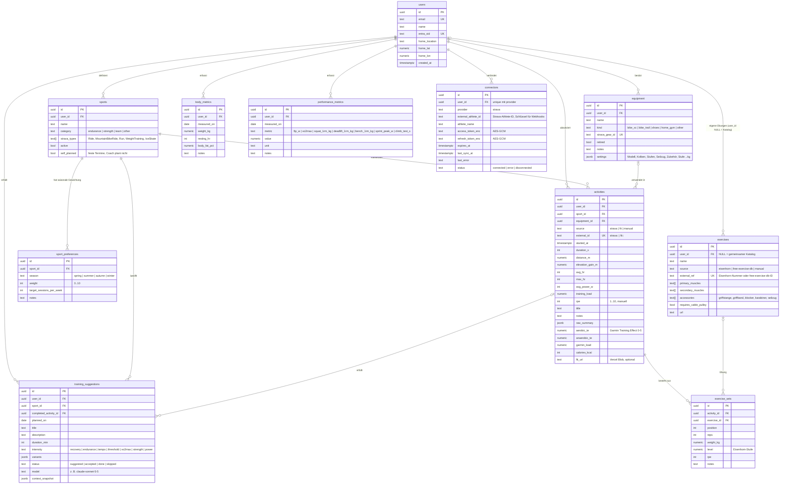

# 03 – Datenmodell

Quelle der Wahrheit ist `src/db/schema.ts` (Drizzle). Dieses Dokument erklärt
die Zusammenhänge.

## Migrationen und Seed

- Migrationen liegen in `drizzle/` und entstehen mit `npm run db:generate` aus
  `src/db/schema.ts`; `npm run db:migrate` (`scripts/migrate.ts`, Neon-HTTP-Treiber,
  läuft auch in Cloud-Sessions) spielt sie ein (`db:push` nur für Wegwerf-Datenbanken).
- Eindeutigkeit: `sports(user_id, name)`, `equipment(user_id, name)` und
  `sport_preferences(sport_id, season)`. Dadurch sind Seed und Speichern der
  Präferenzen idempotente Upserts.
- Der Benutzer wird beim ersten Seitenaufruf nach dem Login aus der Session
  angelegt (`lib/users.ts`, Upsert über `entra_oid`).
- Seed (`lib/domain/seed-data.ts`, Ausführung in `lib/master-data/seed.ts`):
  Sportarten Mountainbike, Jogging, Kraft Studio, Kraft Eisenhorn, Eishockey
  und «Sonstiges» mit Gewichtung je Saison sowie die Geräte «XC-Bike» und
  «Trail-Bike». Läuft über `npm run db:seed -- <email>` oder den Button
  «Stammdaten anlegen» auf der leeren Sportarten-Seite. Bestehende Sportarten
  (gleicher Name) werden nie überschrieben; Geräte werden nur angelegt, wenn
  noch keines dieses Typs existiert (umbenannte Bikes bleiben allein).

## Fachliche Regeln

- **Saison** wird aus dem Datum abgeleitet (`lib/domain/season.ts`): Frühling März–Mai, Sommer Juni–August, Herbst September–November, Winter Dezember–Februar. Der Athlet kann die Gewichtung pro Sportart und Saison in `sport_preferences` setzen (0 = nie, 10 = Schwerpunkt; Validierung und Vervollständigung auf vier Saisons in `lib/domain/preferences.ts`). Fehlt ein Eintrag, gilt Gewichtung 5. Die Sportarten-Seite sortiert nach der Gewichtung der aktuellen Saison.
- **Sportart-Zuordnung** beim Import: Strava `sport_type` → `sports.strava_types`. Nicht zuordenbare Aktivitäten landen in einer Sportart «Sonstiges» und können manuell umgehängt werden.
- **Geräteparameter** (`equipment.settings`, Validierung in `lib/domain/equipment-settings.ts`): nur für Heimtrainingsgeräte wie das Eisenhorn. Modell, Kolben, Anzahl Stufen, Halbstufen, Seilzug, Zubehör und optional die Tabelle Stufe → Kilogramm. Die Widerstandsstufe wird je Kraftsatz erfasst (P2) und über die Tabelle in Kilogramm umgerechnet.
- **Übungskatalog** (ADR 0006): Tabelle `exercises` mit `user_id NULL` für den gemeinsamen Katalog: 161 Eisenhorn-Übungen aus `lib/domain/eisenhorn-catalog.json` (Nummer, Muskelgruppen, Zubehör) und kuratierte Studio-Übungen aus `lib/domain/gym-exercises.ts` (Muskelzuordnung aus free-exercise-db). Elf Muskel-Schlüssel: back, biceps, calves, chest, core, forearms, glutes, legs, neck, shoulders, triceps. Eigene Übungen entstehen beim Erfassen eines Satzes («Neue Übung»). Der Katalog wird mit `npm run db:seed` oder dem Button «Übungskatalog anlegen» befüllt; `feasibleExercises()` filtert Eisenhorn-Übungen nach vorhandenem Zubehör.
- **Manuelle Erfassung** (`lib/domain/activity-input.ts`): Datum und Startzeit werden in `Europe/Zurich` eingegeben und als UTC gespeichert (`lib/domain/time.ts`). Dauer in Minuten, RPE 1–10 (`lib/domain/rpe.ts`), optional Distanz, Höhenmeter, Puls. Die Belastung wird beim Speichern berechnet: HF-basiert, wenn Durchschnitts- und Maximalpuls sowie ein Ruhepuls aus `body_metrics` vorliegen, sonst aus Dauer × RPE.
- **Kraftsätze** (`lib/domain/strength.ts`): je Satz Wiederholungen plus Gewicht in kg (Studio) oder Eisenhorn-Stufe; Kilogramm aus der Stufe über `equipment.settings.kgPerLevel`. `setsByMuscle()` zählt Sätze je Muskelgruppe (Primär 1, Sekundär 0.5) als Grundlage für Vorschläge in P6.
- **Körper- und Leistungswerte** (`lib/domain/metrics.ts`): Gewicht und Ruhepuls pro Tag, Leistungswerte mit Einheit je Kennzahl; `weightTrend()` liefert das 7-Tage-Mittel.
- **Ausrüstung** beim Import: Strava `gear_id` → `equipment.strava_gear_id`. Unbekanntes Gear wird automatisch als neues Gerät angelegt (Name aus Strava, MTB-Rahmen → Trail-Bike als Vorschlag, sonst «Sonstiges»), Typ wird nachträglich gesetzt. Bestehende Geräte bekommen ihre Gear-ID im Geräteformular über die Auswahl «Aus Strava übernehmen» (Bikes und Schuhe aus dem Strava-Profil); die Namen müssen nicht übereinstimmen. Heisst ein Gerät trotzdem gleich wie das Strava-Gear, trägt der Import die Gear-ID automatisch nach.
- **Strava-Import** (`lib/domain/strava-mapping.ts`, `lib/strava/sync.ts`): `activities.external_id` = `strava:<id>`, Quelle `strava`. Beim Aktualisieren bleiben manuell gesetzte Sportart und Gerät erhalten, Messwerte und Titel werden übernommen; nur die Auffang-Sportart «Sonstiges» wird ersetzt, sobald eine Sportart den Strava-Typ abdeckt. `raw_summary` enthält nur Strava-ID, Sporttyp, Gear-ID und Trainer-Flag, keine Streams. Belastung aus Leistung (nur `device_watts`) mit FTP aus `performance_metrics`, sonst Puls (Ruhepuls aus `body_metrics`, Rückfall 60), sonst 0. Ein erneuter Abgleich berechnet die Belastung neu.
- **FIT-Upload** (`lib/domain/fit-mapping.ts`, `lib/fit/`): `external_id` = `fit:<Seriennummer>:<Erstellzeit>`, Quelle `fit`. Sportart über den Strava-Typ, auf den Garmin-Sport und -Unterart abgebildet werden (`cycling/mountain` → `MountainBikeRide`), Belastung wie beim Strava-Import. Eine bestehende Aktivität mit Start innerhalb von drei Minuten und Dauer innerhalb von 25 % oder 10 Minuten wird ergänzt (Garmin-Werte, fehlende Messwerte), nicht doppelt angelegt. VO2max aus der Datei landet als `performance_metrics.vo2max` am Tag der Aktivität, höchstens einmal pro Tag (ADR 0007).
- **Belastung** (`training_load`): wenn Leistungsdaten vorhanden, TSS-ähnlich aus Leistung und FTP; sonst HF-basiert (TRIMP); bei Kraft und Eishockey aus Dauer × RPE. Berechnung in `lib/domain/load.ts`, bewusst einfach und nachvollziehbar.
- **Fortschritt** (`lib/domain/progress.ts`): Vergleich der letzten 28 Tage mit den 28 davor (Einheiten, Zeit, Belastung, Höhenmeter), Belastung je Kalenderwoche ab Montag (Zürich), Stunden je Monat und Sportart über 12 Monate, Gewichtsreihe mit 7-Tage-Mittel, Veränderung je Leistungskennzahl gegenüber der vorherigen Messung.
- **Selbst geplante Sportarten** (`sports.self_planned`): feste Termine wie Eiszeiten plant der Athlet selbst. Der Coach bekommt die Sportart mit `selfPlanned: true` im Kontext, schlägt dafür keine Einheiten vor und rechnet ihre Belastung über die Wochen-Aggregate mit; schlägt das Modell sie trotzdem vor, werden diese Einheiten beim Speichern verworfen.
- **KI-Wochenplan** (`lib/domain/coach-context.ts`, `lib/ai/plan.ts`, `lib/master-data/suggestions.ts`): Der Kontext enthält aktive Sportarten mit Gewicht der aktuellen Saison, aktive Geräte, die letzten 4 Kalenderwochen als Summen je Sportart, neueste Körper- und Leistungswerte, 7-Tage-Wetter, Hinweise aus dem Formular und den Eisenhorn-Kontext (Sätze je Muskelgruppe der letzten 14 Tage, vernachlässigte Muskeln, bis 24 machbare Übungen ohne grossen Umbau). Der Plan wird als Zeilen in `training_suggestions` gespeichert: `variants` trägt Varianten, Begründung, Gerät, bei Kurz-Einheiten die Übungen und die Plan-Zusammenfassung; `context_snapshot` den vollständigen Kontext (ADR 0004). Ein neuer Plan ersetzt offene und übersprungene Vorschläge ab heute, angenommene und erledigte bleiben.
- **Vorschläge** werden nie automatisch zu Aktivitäten. Erst wenn eine passende Aktivität importiert wird oder der Athlet sie als erledigt markiert, wird `completed_activity_id` gesetzt.
- **Erfüllung** (`lib/domain/plan-match.ts`, `lib/master-data/suggestions.ts`): Nach dem Anlegen einer Aktivität (manuell, Strava-Import, FIT-Upload) wird der passende offene Vorschlag gesucht: gleiche Sportart, geplanter Tag innerhalb ±1 Tag des Aktivitätstags (Zürich), Status vorgeschlagen oder angenommen. Bei mehreren gewinnt der gleiche Tag, dann die nächste Dauer. Treffer → Status `done` mit `completed_activity_id`. Wird die Aktivität gelöscht, geht der Vorschlag auf `accepted` zurück. Die Wochenbilanz zählt Vorschläge und Aktivitäten der Kalenderwoche ab Montag (Zürich); übersprungene zählen nicht als geplant.
