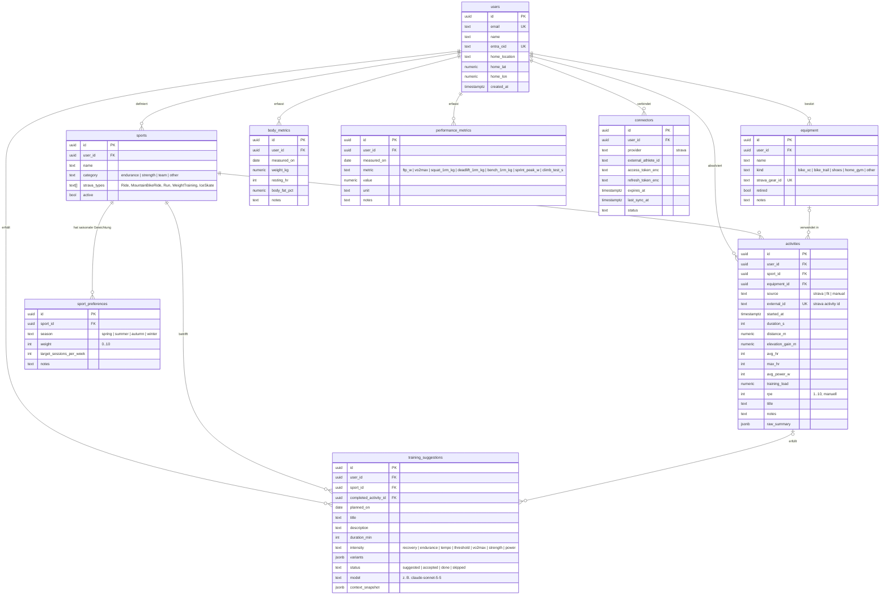

# 03 – Datenmodell

Quelle der Wahrheit ist `src/db/schema.ts` (Drizzle). Dieses Dokument erklärt
die Zusammenhänge.

## Fachliche Regeln

- **Saison** wird aus dem Datum abgeleitet (`lib/domain/season.ts`): Frühling März–Mai, Sommer Juni–August, Herbst September–November, Winter Dezember–Februar. Der Athlet kann die Gewichtung pro Sportart und Saison in `sport_preferences` setzen (0 = nie, 10 = Schwerpunkt).
- **Sportart-Zuordnung** beim Import: Strava `sport_type` → `sports.strava_types`. Nicht zuordenbare Aktivitäten landen in einer Sportart «Sonstiges» und können manuell umgehängt werden.
- **Ausrüstung** beim Import: Strava `gear_id` → `equipment.strava_gear_id`. Unbekanntes Gear wird automatisch als neues Gerät angelegt (Name aus Strava), Typ wird nachträglich gesetzt.
- **Belastung** (`training_load`): wenn Leistungsdaten vorhanden, TSS-ähnlich aus Leistung und FTP; sonst HF-basiert (TRIMP); bei Kraft und Eishockey aus Dauer × RPE. Berechnung in `lib/domain/load.ts`, bewusst einfach und nachvollziehbar.
- **Fortschritt**: Vergleich rollierender 4-Wochen-Fenster (Volumen, Belastung, Höhenmeter), Trend der `performance_metrics` je Metrik, Gewichtstrend als 7-Tage-Mittel.
- **Vorschläge** werden nie automatisch zu Aktivitäten. Erst wenn eine passende Aktivität importiert wird oder der Athlet sie als erledigt markiert, wird `completed_activity_id` gesetzt.
