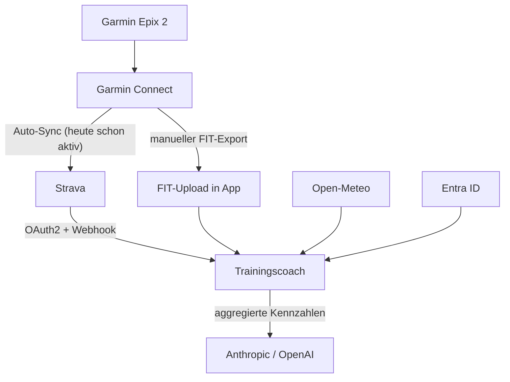

# 04 – Integrationen und Connectoren

## Übersicht

## Garmin Connect: Stand Oktober 2026

Der Garmin Connect Developer Program (Health/Activity/Training API) ist **nur
für genehmigte Geschäftskunden** gedacht, und seit Sommer 2026 nimmt Garmin
**keine neuen Anträge** mehr an (Antragsformular entfernt, kein Datum für
Wiedereröffnung). Für ein Hobby-Projekt ist eine direkte Anbindung deshalb
nicht realistisch.

Konsequenz für die App:

1. **Strava ist der primäre Connector.** Garmin Connect synchronisiert
   Aktivitäten automatisch nach Strava, inklusive Herzfrequenz, Leistung,
   Höhenmeter. Die Ausrüstung (Gear) wird ohnehin in Strava gepflegt.
2. **FIT-Upload als Fallback und für Zusatzdaten.** Garmin Connect erlaubt den
   Export einzelner Aktivitäten als FIT. Die App parst FIT-Dateien selbst
   (Bibliothek `@garmin/fitsdk`), damit auch Daten verfügbar sind, die Strava
   nicht weitergibt (z. B. Garmin-Trainingsbelastung, VO2max-Schätzung).
3. **Körperdaten manuell.** Gewicht, Ruhepuls und VO2max werden in der App
   erfasst (schnelle Eingabemaske), bis ein offizieller Weg zu Garmin-Daten
   besteht.
4. **Nicht verwendet:** inoffizielle Garmin-Connect-Bibliotheken (Scraping der
   Web-Session). Sie brechen regelmässig und verstossen gegen die
   Nutzungsbedingungen; für eine gehostete App ungeeignet.

Der Connector-Typ `garmin` bleibt im Datenmodell vorgesehen, damit er später
ohne Umbau ergänzt werden kann.

## Strava

### Was genutzt wird

| Endpoint | Zweck |
|---|---|
| OAuth2 `https://www.strava.com/oauth/authorize`, Scope `read,activity:read_all,profile:read_all` | Verbindung herstellen |
| `GET /athlete/activities` | Initial-Import und nächtlicher Abgleich |
| `GET /activities/{id}` | Detail inkl. `gear_id`, `sport_type`, HF, Leistung |
| `GET /gear/{id}` | Name, Typ, Distanz der Ausrüstung |
| Webhook Subscription `POST /push_subscriptions` | Neue Aktivität sofort übernehmen |

Rate-Limits (Stand 2026: 200 Anfragen pro 15 Minuten, davon 100 lesend,
2'000 pro Tag) sind für einen Benutzer unkritisch: der 12-Monats-Import
braucht wenige Listen-Anfragen (200 Aktivitäten je Seite) plus eine Anfrage je
unbekanntem Gear. Tokens laufen nach 6 Stunden ab und werden kurz vor Ablauf
über den Refresh-Token erneuert; beide werden mit AES-GCM verschlüsselt
gespeichert (`src/lib/crypto.ts`).

### API-Bedingungen und KI

Die Strava-API-Vereinbarung (Stand November 2024, verschärft Juni 2026)
verbietet die Nutzung von API-Daten «in KI-Modellen oder ähnlichen
Anwendungen» und erlaubt die Anzeige nur gegenüber dem Athleten selbst.
Ob einzelne Inferenz-Anfragen (ohne Training eines Modells) darunter fallen,
hat Strava öffentlich nicht geklärt.

Gewählter Umgang (siehe ADR 0004):

- Die App zeigt Strava-Daten nur dem eigenen Benutzer. Erfüllt.
- An das LLM gehen **keine Rohdaten aus der Strava-API**, sondern nur
  von der App berechnete, aggregierte Kennzahlen (Wochenvolumen, Belastung,
  Anzahl Einheiten je Sportart) sowie manuell erfasste Daten und FIT-Uploads.
- Wer ganz sicher gehen will, nutzt den FIT-Upload als einzige Datenquelle;
  die App funktioniert ohne Strava vollständig.

### Einrichtung

Siehe `docs/setup/strava.md`.

## Microsoft Entra ID (M365-Login)

- Auth.js v5, Provider `microsoft-entra-id`
- App-Registrierung im eigenen Tenant, Kontotyp «Nur Konten in diesem Organisationsverzeichnis»
- Redirect-URI: `https://<host>/api/auth/callback/microsoft-entra-id`
- Env: `AUTH_MICROSOFT_ENTRA_ID_ID`, `AUTH_MICROSOFT_ENTRA_ID_SECRET`,
  `AUTH_MICROSOFT_ENTRA_ID_ISSUER=https://login.microsoftonline.com/<tenant-id>/v2.0`, `AUTH_SECRET`
- Zusätzliche Allowlist `ALLOWED_EMAILS` in der App (Komma-getrennt)

Siehe `docs/setup/entra-id.md`.

## KI-Anbieter

- Vercel AI SDK, Anbieter per `AI_PROVIDER=anthropic|openai`
- Standardmodelle: Anthropic `claude-sonnet-5-5` (Preis/Leistung), für
  aufwändige Saisonplanung optional `claude-opus-5-5`; OpenAI-Modell per
  `OPENAI_MODEL` konfigurierbar
- Strukturierte Ausgabe (Zod-Schema) statt Freitext, damit Vorschläge
  speicherbar und in den Wochenplan übernehmbar sind
- Keys: `ANTHROPIC_API_KEY`, `OPENAI_API_KEY` nur als Vercel-Env
- Ablauf (P6): Seite `/coach` → Server Action → `lib/ai/plan.ts` baut den Kontext
  (nur Aggregate, ADR 0004), holt das Wetter, ruft `generateObject` mit dem
  Wochenplan-Schema und speichert die Einheiten als `training_suggestions`.
  Prompt-Regeln: Saison-Gewichtung und Zielhäufigkeit, Wochenbelastung maximal
  +10 % gegenüber dem 4-Wochen-Mittel, Entlastungswoche alle 3–4 Wochen,
  Wetterregel (Regen > 60 % oder Schnee → Indoor), Ruhetag, keine harten
  Einheiten an Folgetagen, Eisenhorn-Kurz-Einheiten nur aus der Kandidatenliste,
  selbst geplante Sportarten (feste Termine, `self_planned`) nie einplanen
- Planprüfung (P7): zweiter Prompt in `lib/ai/review.ts` mit Schema
  `planReviewSchema`; prüft statt zu planen, nennt betroffene Einheiten mit
  Datum und Titel, höchstens 8 Befunde und 8 Verbesserungen
- Test ohne UI: `npm run coach:try -- winter-snow` (Fixture mit Eisenhorn-Kontext)

## Wetter

- Open-Meteo Forecast API, ohne API-Key, Koordinaten des Heimatorts (Standard: Plaffeien FR, 46.743 / 7.288)
- Genutzt: Tagesmaximum/-minimum, Niederschlagssumme und -wahrscheinlichkeit, Wind, Schneefallgrenze (Winter)
- Einfluss auf Vorschläge: Regen/Schnee → Indoor-Varianten (Studio, Eisenhorn, Rolle), gutes Wetter im Sommer → MTB-Tour priorisieren

## Connector-Verwaltung in der App

Seite `/settings/connectors`:

- Strava: verbinden (OAuth), Status, letzter Sync, manueller Sync, trennen (Token widerrufen und löschen)
- Garmin: Hinweis «nicht verfügbar», FIT-Upload-Link
- KI: aktiver Anbieter und Modell anzeigen (nur lesend; Keys sind Env-Variablen)
- Wetter: Heimatort und Koordinaten

## Eisenhorn (Hersteller-Inhalte)

Keine API. Der Übungskatalog (Nummer, Name, Muskelgruppen, Zubehör) liegt als
Fakten in `src/lib/domain/eisenhorn-catalog.json`; Anleitung und Video werden
auf `eisenhorn.com/de-ch/training/kraftuebungen/<slug>/` verlinkt, nie
kopiert. Aktualisierung manuell, siehe ADR 0006.
