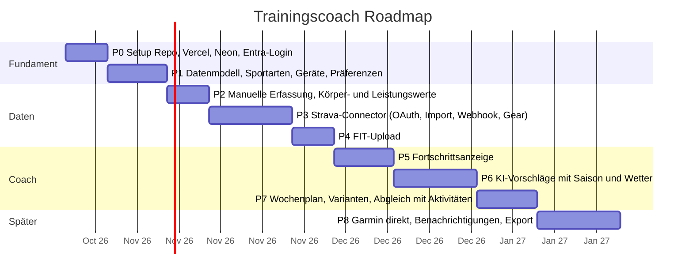

# 05 – Roadmap

Jede Phase ist in einer oder wenigen Claude-Code-Sessions machbar und endet
mit einem deploybaren Stand auf Vercel.

## Phasen im Detail

### P0 – Fundament (dieses Gerüst)
- [x] Next.js 16, TypeScript, Tailwind, Auth.js, Drizzle, AI SDK im Repo
- [x] Doku-Struktur, ADRs, CLAUDE.md, Projekt-Skills
- [ ] GitHub-Repo anlegen und pushen
- [ ] Vercel-Projekt und Neon-DB verbinden, Env-Variablen setzen
- [ ] Entra-App-Registrierung, Login funktioniert in Production
- Fertig wenn: Login mit M365-Konto auf der Vercel-URL klappt, CI grün

### P1 – Stammdaten
- [x] Migrationen für alle Tabellen (`drizzle/`, `npm run db:migrate`)
- [x] Seiten: Sportarten (mit saisonaler Gewichtung), Geräte
- [x] Seed mit den bekannten Sportarten und zwei Bikes (`npm run db:seed` oder Button «Stammdaten anlegen»)
- [x] Migration und Seed gegen die Neon-DB ausgeführt
- [x] Präferenzen nach dem ersten Login in Production geprüft
- [x] Geräteparameter (Eisenhorn: Kolben, Stufen, Zubehör) und Übungskatalog als Daten (ADR 0006)
- Fertig wenn: Präferenzen pro Saison gepflegt und persistiert

### P2 – Manuelle Erfassung
- [x] Aktivität manuell erfassen (Sportart, Dauer, RPE 1–10 mit Wortlabels, Gerät), bearbeiten, löschen
- [x] Kraftsätze je Übung erfassen (Tabelle `exercises` aus Eisenhorn-Katalog und kuratierten Studio-Übungen, `exercise_sets` mit Wiederholungen, kg oder Eisenhorn-Stufe)
- [x] Körpergewicht/Ruhepuls schnell erfassen, Leistungswerte erfassen
- [ ] Erste echte Einheiten in Production erfasst (Eishockey, Studio, Eisenhorn)
- Fertig wenn: Eishockey-Abend und Studio-Training in 30 Sekunden erfasst

### P3 – Strava
- [x] OAuth-Flow, verschlüsselte Token-Ablage, Trennen mit Deauthorize
- [x] Initial-Import (letzte 12 Monate), Webhook mit `after()`, nächtlicher Cron (30 Tage)
- [x] Gear-Abgleich mit Geräten (unbekanntes Gear wird angelegt), Sportart-Mapping über `strava_types`
- [x] In Production verbunden, 150 Aktivitäten importiert, Webhook-Subscription angelegt, Gear-IDs der Bikes gesetzt
- Fertig wenn: neue Garmin-Aktivität erscheint ohne Zutun in der App mit richtigem Bike

### P4 – FIT-Upload
- [x] Upload unter `/activities/upload` (bis 10 Dateien, 4 MB), Parsing mit dem Garmin FIT SDK (ADR 0007)
- [x] Dedup: gleiche Datei → aktualisieren, gleiche Einheit aus Strava → ergänzen, sonst neue Aktivität
- [x] Zusatzwerte Training Effect, Garmin-Belastung, Kalorien auf der Aktivität; VO2max als Leistungswert
- [x] Ablage in Vercel Blob, wenn `BLOB_READ_WRITE_TOKEN` gesetzt ist
- Fertig wenn: FIT-Datei liefert Zusatzwerte (Garmin-Belastung, VO2max)

### P5 – Fortschritt
- [x] Übersicht: letzte 4 Wochen je Sportart (Einheiten, Zeit, Belastung) als Balken
- [x] Aktivitäten nach Monat gruppiert mit Summen je Sportart
- [x] Seite Fortschritt: 4 Wochen gegenüber den 4 davor (Einheiten, Zeit, Belastung, Höhenmeter), Belastung je Woche (12 Wochen), Jahresübersicht je Sportart und Monat, Gewicht 90 Tage mit 7-Tage-Mittel, Leistungswerte mit Veränderung
- Fertig wenn: 4-Wochen-Vergleich und Jahresübersicht sichtbar

### P6 – KI-Vorschläge
- [x] Kontextaufbau aus der DB (`lib/domain/coach-context.ts`, `lib/ai/plan.ts`): Saison-Gewichtung, Wochen-Aggregate der letzten 4 Wochen, Geräte, Werte, Wetter, Hinweise
- [x] Prompt und Zod-Schema mit Varianten (Indoor/Outdoor, kurz/lang), Provider-Umschaltung (ADR 0005)
- [x] Eisenhorn-Kurz-Einheiten nach Muskelgruppe: 5–10 Minuten, 1–2 Übungen ohne grossen Umbau, nur mit vorhandenem Zubehör, Muskeln, die in 14 Tagen nicht dran waren (ADR 0006)
- [x] Seite «Coach»: Plan erzeugen, Tage mit Einheiten, Annehmen/Überspringen; Übersicht zeigt die nächsten Vorschläge
- Fertig wenn: Wochenvorschlag passt zu Saison, Wetter und letzter Belastung (mit echtem Key prüfen)

### P7 – Wochenplan
- [x] Vorschläge annehmen, überspringen, verschieben (Datum), erledigen, zurücksetzen
- [x] Automatische Erfüllung: neue Aktivität (manuell, Strava, FIT) erledigt den passenden offenen Vorschlag (gleiche Sportart, ±1 Tag); «Mit Aktivitäten abgleichen» für bereits importierte; Löschen der Aktivität öffnet den Vorschlag wieder
- [x] Eigene Einheiten planen (alle Sportarten, auch selbst geplante wie Eishockey): gelten als angenommen, bleiben beim Coach-Plan stehen, der Coach plant um sie herum
- [x] Plan prüfen lassen: der Coach bewertet die geplante Woche (Belastung, Erholung, Saison, Wetter, Muskel-Balance) und schlägt konkrete Verbesserungen vor; Prüfung wird gespeichert
- [x] Rückblick auf der Übersicht bewertet die letzten 4 Wochen nach Leistungsnutzen: Grundlage, Intensität, lange Einheiten, Kraft, Steigerung, Regelmässigkeit, Erholung
- [x] Plan gegen Ist je Kalenderwoche auf der Coach-Seite: erledigte von geplanten Einheiten, trainierte von geplanten Minuten, je Sportart Balken (trainiert) mit Rahmen (geplant)
- Fertig wenn: Plan vs. Ist pro Woche sichtbar

### P8 – Später
- Garmin-Connector, sobald der Developer Program wieder offen ist
- Push/Mail am Sonntagabend mit Wochenplan
- Export (CSV), Jahresrückblick
