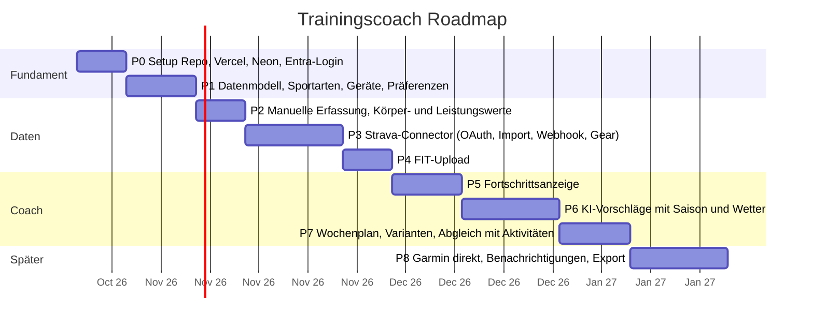

# 05 – Roadmap

Jede Phase ist in einer oder wenigen Claude-Code-Sessions machbar und endet
mit einem deploybaren Stand auf Vercel.

## Phasen im Detail

### P0 – Fundament (dieses Gerüst)
- [x] Next.js 16, TypeScript, Tailwind, Auth.js, Drizzle, AI SDK im Repo
- [x] Doku-Struktur, ADRs, CLAUDE.md, Projekt-Skills
- [ ] GitHub-Repo anlegen und pushen
- [ ] Vercel-Projekt und Neon-DB verbinden, Env-Variablen setzen
- [ ] Entra-App-Registrierung, Login funktioniert in Production
- Fertig wenn: Login mit M365-Konto auf der Vercel-URL klappt, CI grün

### P1 – Stammdaten
- [x] Migrationen für alle Tabellen (`drizzle/`, `npm run db:migrate`)
- [x] Seiten: Sportarten (mit saisonaler Gewichtung), Geräte
- [x] Seed mit den bekannten Sportarten und zwei Bikes (`npm run db:seed` oder Button «Stammdaten anlegen»)
- [x] Migration und Seed gegen die Neon-DB ausgeführt
- [x] Präferenzen nach dem ersten Login in Production geprüft
- [x] Geräteparameter (Eisenhorn: Kolben, Stufen, Zubehör) und Übungskatalog als Daten (ADR 0006)
- Fertig wenn: Präferenzen pro Saison gepflegt und persistiert

### P2 – Manuelle Erfassung
- [x] Aktivität manuell erfassen (Sportart, Dauer, RPE 1–10 mit Wortlabels, Gerät), bearbeiten, löschen
- [x] Kraftsätze je Übung erfassen (Tabelle `exercises` aus Eisenhorn-Katalog und kuratierten Studio-Übungen, `exercise_sets` mit Wiederholungen, kg oder Eisenhorn-Stufe)
- [x] Körpergewicht/Ruhepuls schnell erfassen, Leistungswerte erfassen
- [ ] Erste echte Einheiten in Production erfasst (Eishockey, Studio, Eisenhorn)
- Fertig wenn: Eishockey-Abend und Studio-Training in 30 Sekunden erfasst

### P3 – Strava
- OAuth-Flow, verschlüsselte Token-Ablage
- Initial-Import (letzte 12 Monate), Webhook, nächtlicher Cron
- Gear-Abgleich mit Geräten, Sportart-Mapping
- Fertig wenn: neue Garmin-Aktivität erscheint ohne Zutun in der App mit richtigem Bike

### P4 – FIT-Upload
- Upload nach Vercel Blob, Parsing, Dedup gegen Strava-Import
- Fertig wenn: FIT-Datei liefert Zusatzwerte (Garmin-Belastung, VO2max)

### P5 – Fortschritt
- Dashboard: Wochenvolumen je Sportart, Belastungstrend, Gewichtstrend, Leistungsmetriken
- Fertig wenn: 4-Wochen-Vergleich und Jahresübersicht sichtbar

### P6 – KI-Vorschläge
- Kontextaufbau (aggregiert), Prompt, Zod-Schema, Provider-Umschaltung
- Wetter-Einbindung, Varianten (Indoor/Outdoor, kurz/lang)
- Eisenhorn-Einheiten nach Muskelgruppe: 5–10 Minuten, 1–2 Übungen mit gleichem Aufbau, nur mit vorhandenem Zubehör, Muskeln, die zuletzt nicht dran waren (ADR 0006)
- Fertig wenn: Wochenvorschlag passt zu Saison, Wetter und letzter Belastung

### P7 – Wochenplan
- Vorschläge annehmen, verschieben, erledigen; automatische Erfüllung durch importierte Aktivität
- Fertig wenn: Plan vs. Ist pro Woche sichtbar

### P8 – Später
- Garmin-Connector, sobald der Developer Program wieder offen ist
- Push/Mail am Sonntagabend mit Wochenplan
- Export (CSV), Jahresrückblick
